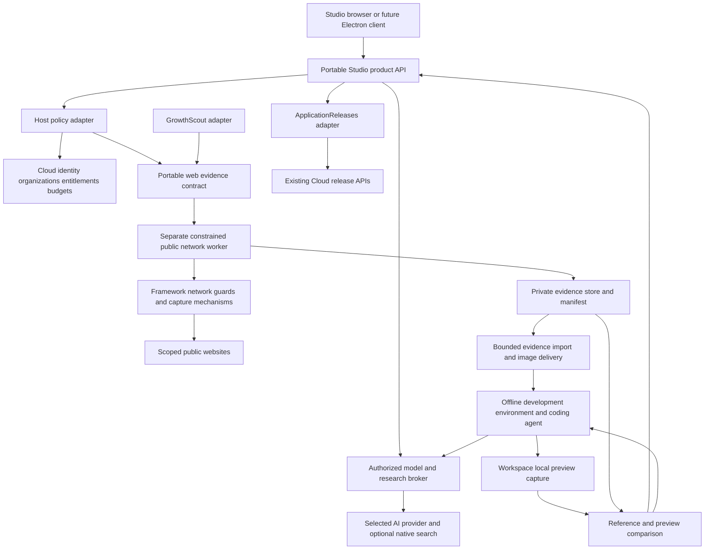

# AI web capabilities for Framework and Studio

Proposal, 14 November 2026. This is exploration and implementation planning, not an implemented API or permission to deploy. It covers public web research, page reading, visual capture and bounded crawling across Framework, Studio and Cloud, with GrowthScout as a consumer and extraction source.

Build two complementary capabilities: provider-native research through a policy-enforcing AI broker, and provider-independent web evidence through a separately constrained worker. Start with one reference URL, desktop and mobile captures, an offline coding turn and a comparison with the resulting local preview. Full-site reconstruction follows after this loop works.

User-supplied screenshots are an earlier useful increment: paste, drop or upload an image with a message, then use the same private evidence storage and model-image delivery needed by URL capture. Screenshot sharing does not require public network access.

## Current capabilities and gaps

These findings describe the local source inspected on this date. Existing tests are evidence of intended coverage, not a claim that they were executed during this exploration.

| Capability | Implemented source | Missing for this use case |
| --- | --- | --- |
| Provider-native web search in Framework | `packages/app/src/ai/index.ts` exports `webSearchTool` from the Agents SDK. `Agent.ts` normalizes hosted-tool events, retains URL citations and records completed search actions. | An authorized path from Studio's separate Codex broker; provider/model capability qualification. Framework support does not automatically apply to Studio. |
| Provider usage and citations | Framework has request tracking, citation normalization, hosted-tool counts and pricing completeness handling. | Studio currently records input/cached/output tokens from completed Responses events. It needs durable provider/tool usage, source annotations, duplicate-event handling and incomplete-usage reconciliation. Neither those counts nor request ceilings implement credit settlement. |
| Coding isolation | Studio's `server/environments/docker.ts` creates offline containers with `--network none`, a read-only root, resource limits and a private named workspace volume. The provider credential stays outside. | A separate public-network capability; opening the coding container's network is unnecessary. |
| Native search admission in Studio | `docker.ts` sets `web_search="disabled"`. `server/provider.ts` recursively permits only function/custom declarations and their namespaces. | Explicit host-issued tool grants and broker normalization, rather than accepting arbitrary hosted tools. |
| Runtime pin | `workspaces/studio/sandbox/Dockerfile` installs Codex **0.159.0**, Chromium and Playwright Core **1.61.1**. The configured model defaults to `gpt-6.1-sol`. | Compatibility proof against that exact app-server version, model and custom Responses endpoint. Current documentation alone does not prove the pin supports every current mode or tool schema. |
| Public HTTP access | Framework `network` exports `guardedFetch`, `assertPublicUrl`, connect-time DNS checks and streaming decoded-body limits. Redirects are checked individually and sensitive headers are removed on origin changes. | Application scope, extraction, resource budgets, provenance and job lifecycle above these primitives. |
| Public browser protection | `network/playwright` exports `newGuardedBrowserContext`: authenticated per-context proxy, connect-time destination checks, service workers/WebSockets disabled and cleanup on context closure. Cloud Test Engineer uses it. | Capture contracts, aggregate limits, page/resource scope and stronger worker isolation. Existing proxy options provide inactivity timeouts, not complete job/byte/request/redirect budgets. |
| Browser-rendered page reading | Scout `renderWebsitePreview.ts` executes JavaScript and returns final URL, status, content type and DOM. It uses guarded contexts, cancellation and a sandboxed Chromium launch configuration. | Screenshots and visual fidelity: images, fonts and media are currently blocked. Rendering and extraction also need explicit byte/DOM/output limits. |
| Multi-page crawling | Scout `webCrawler.ts` uses Cheerio/Crawlee, same-origin link discovery, bounded scheduling, progress, cancellation/fences, hashes and persistence. `WebsiteSitemap.ts` bounds same-origin sitemap traversal. `boundCrawlerResponse.ts` bounds decoded response streams. | A reusable crawl engine independent of Scout models, analysis jobs, reporting and billing; rendered-page capture and asset mapping. Current sitemap limits are Scout choices, not proposed Studio defaults. |
| Local preview verification | Studio's `sandbox/browser.mjs` captures a local preview and checks visible text and uncaught page errors. It uses a fixed 1280 × 800 viewport and only permits the local app origin. | Matched desktop/mobile comparison, evidence export and agent image consumption. Its offline browser launch uses `--no-sandbox`; do not copy that configuration to public-page workers. |
| Evidence transfer and vision | Studio has source import/export and text prompts. `CodexAdapter.run()` creates text-only turn inputs. The environment contract exposes inspect/check/snapshot, not evidence import. | A bounded binary evidence channel, explicit image consumption and private artifact retrieval. A screenshot path in a text message is not proof that the model saw an image. |
| User screenshot sharing | Studio's composer/message contracts expose no image attachment upload or image input path; initial and steering turns send text. Canvas context supplies structured observations, not screenshots. | Paste/drop/file selection, image validation/storage, attachment references in initial and queued/steering messages, transcript thumbnails and qualified image delivery to Codex. |
| Publication | Portable `ApplicationReleases` and Cloud `coding_releases` provide prepare, publish, status and compatible rollback. Checked source is frozen and hashed. | No new deployment engine is needed. Existing-app schema, dependency and runtime changes are deliberately rejected by the first publication slice. |
| Portability | Studio's public package, environment contract, remote runner and optional Cloud adapters already separate its core from Cloud. | Injectable web evidence and research adapters using the same contracts locally, in Electron and on customer-owned compute. Electron packaging and alternative coding harnesses remain future work. |

## OpenAI native tools

Official Codex guidance documents `cached`, `indexed`, `live` and `disabled` web-search modes. Cached results are pre-indexed; indexed access is gated by the search index. These are Codex configuration modes, not four interchangeable Responses API parameters. [Codex configuration](https://learn.chatgpt.com/docs/config-file/config-basic#web-search-mode).

Responses supports the hosted `web_search` tool, with search and, on supported reasoning models, `open_page` and `find_in_page` actions. These actions appear in `web_search_call` output; they are not three separate function tools to register. Current controls include domain filtering, sources and live-access selection. URL annotations must be shown as prominent clickable citations. [Responses web search](https://developers.openai.com/api/docs/guides/tools-web-search#output-and-citations).

Use native search for discovery and cited research. Use DB3 capture for reproducible visual evidence, assets and bounded site traversal. Native page opening does not establish a screenshot, rendered DOM or complete asset bundle.

Native research executes on the provider's infrastructure and does not pass through DB3's network guard. Its domain filters are not equivalent to the capture worker's exact-origin, URL-path or request-by-request policy. Where those stricter guarantees are required, use the DB3 evidence path and do not advertise native research as satisfying them.

Enabling Studio search requires coordinated runtime configuration, broker admission, accounting and UI changes. Changing only `web_search` will still encounter the broker rejection. Changing only the broker will leave the runtime tool disabled. Qualification must inspect actual declarations/events from Codex 0.159.0 using a synthetic provider, including any legacy preview declaration; do not assume current documented controls work on that declaration.

## Ownership and data flow



Framework owns reusable URL policy extensions, fetch/extraction, browser capture, crawl primitives, evidence contracts and optional AI-tool adapters. Keep `network` concerned with transport enforcement. Add a cohesive optional `web` module with an optional `web/playwright` entry point; avoid making Chromium a dependency of ordinary AI or HTTP use. Initially use explicit functions/adapters rather than adding a mandatory global service or database model.

Cloud owns authenticated tenant policy, permissions, durable admission, quotas, managed worker placement, retention policy, usage settlement and publication. An optional app such as `apps/web_tools` can expose a named `contract.ts`, with an out-of-process worker on separate compute. Follow Cloud app manifest and architecture checks. It should not turn the portal HTTP process into a browser worker.

Studio owns user intent, run orchestration, reference attachment, evidence display and the coding/comparison loop. Its package accepts an injected web client and artifact reader; only its Cloud host adapter imports the optional Cloud contract. GrowthScout retains its models, analysis, product reporting and billing while consuming the same mechanisms. Neither app imports the other's implementation.

Standalone and Electron installations use the same server contracts with operator-selected local or remote workers, local private storage or S3, and a BYO provider adapter. Local public browsing still requires a separate constrained worker. Electron's renderer receives neither filesystem nor provider privileges. Managed Cloud services remain optional; a standalone local actor is resolved by its trusted service, not a fake Cloud organization.

## Proposed contracts

These names are draft contracts, not existing exports. Model tools receive narrow arguments; trusted services supply the actor, scope, deadline, allowed origins and budget. Never accept a model-supplied tenant identity, private-network exception, credential, filesystem output path or arbitrary browser script.

| Operation | Model-facing arguments | Result and authority |
| --- | --- | --- |
| `web_search` through a provider adapter | Bounded query and requested freshness | Cited answer, consulted sources when available, provider call IDs and reported usage. Broker chooses provider, tool configuration and effective limits. A DB3 wrapper must use a distinct tool name if exposed alongside native `web_search`. |
| `web_read_page` | Public URL | Page metadata, bounded extracted text, links, provenance and artifact IDs. HTTP-first; explicitly request a rendered variant when required. |
| `web_capture_page` | Public URL and named viewport profile | Desktop/mobile evidence bundle, resource inventory, warnings and artifacts. Profile dimensions and limits come from policy. No unrestricted Playwright evaluation/action API. |
| `web_crawl` later | Seed URL and bounded purpose | Durable job receipt, selected-page manifests, crawl graph and explicit truncation/failure reasons. Effective page/depth/path limits are host policy. |
| Job get/cancel | Opaque job ID | Host-authorized progress or cancellation. Every read and cancellation rechecks ownership; knowing an ID grants nothing. |
| `preview_capture` / comparison | Reference bundle ID and workspace-local route | Local preview artifacts and bounded comparison report. Resolves an admitted workspace internally; never accepts an arbitrary private URL. |

The reusable execution boundary should be small:

```ts
/** Host-derived authority and lifecycle; never part of model-controlled JSON. */
interface WebExecutionContext {
	/** Opaque principal/scope resolved by the trusted host adapter. */
	grant: WebGrant;
	/** Cancels network, browser work and publication of late results. */
	signal: AbortSignal;
	/** Writes bounded immutable artifacts to a host-selected private destination. */
	artifacts: EvidenceWriter;
}

/** Portable client implemented by a local worker or authenticated remote service. */
interface WebEvidenceClient {
	/** Fetches and extracts one page under effective host limits. */
	readPage(input: ReadPageRequest, context: WebExecutionContext): Promise<PageEvidence>;
	/** Captures one reference using the approved viewport profiles. */
	capturePage(input: CapturePageRequest, context: WebExecutionContext): Promise<CaptureBundle>;
}
```

`WebGrant`, requests and manifests need runtime schemas, versioning and size bounds. Remote transport serializes an expiring job capability, not an `AbortSignal` or a storage implementation. Cancellation is a separate authenticated request plus a worker lease/deadline. Keep crawl/job interfaces separate until the synchronous capture primitive is established.

A capture manifest should contain:

- `schemaVersion`, immutable bundle ID, job/run correlation, policy version, timestamps and worker/browser version.
- Requested URL, approved effective URL, redirect chain, status and content type. Source URLs may contain only explicitly allowed query parameters; reject credentials and signed/private URL material at admission.
- Viewport, device scale, locale, reduced-motion policy, settle criteria, capture dimensions and bounded scroll settings for every screenshot. Record cookie banners, missing fonts, blocked resources and partial loading.
- Separate artifact references for extracted text, inert DOM, link/asset inventories, original screenshots and smaller model images. Each reference has an opaque ID, role, MIME type, byte count, SHA-256 and source URL where applicable. No public bucket URL or host filesystem path in the client contract.
- Assets mapped from original URL to artifact/hash, detected MIME, dimensions, status and reuse eligibility. Rendering an asset does not authorize redistributing it; uncertain assets stay evidence or become placeholders until the user supplies permitted replacements.
- Counters for attempts, requests, redirects, network bytes, decoded retained bytes, artifacts and elapsed time; warnings, terminal status and a structured reason for truncation/failure.

Search evidence retains provider/model, call/action IDs, query, freshness configuration, source URLs, citation annotations and usage confidence. Capture source evidence remains distinct from model conclusions. A comparison references both immutable bundles and the checked source revision/digest, records observed differences and unknowns, and cannot certify functional or visual equivalence by itself.

## User supplied screenshots

Support clipboard paste, drag/drop and file selection in the same composer, with a thumbnail and remove action before sending. Allow a screenshot with a short instruction such as “build this layout” or “fix the spacing here”, including during an active coding run. Persist attachments with the message and show them when reopening history. Browser and future Electron clients use the same product API; no Electron filesystem privilege is needed.

Add an authenticated upload operation that returns opaque attachment IDs. Send those IDs in an optional `attachments` array on both initial and steering messages. Extend persisted message and queued-delivery contracts together so a delayed message retains its exact text and images. Recheck attachment ownership at upload, message admission and delivery. Stable message retry keys include the ordered attachment identities, and deleting a draft attachment must not delete evidence already retained by a sent message.

Each attachment records `origin: user_upload`, detected MIME, dimensions, byte count, hash and a safe display name, plus the owning message/run. A screenshot has no verified webpage URL, viewport or capture timestamp unless separately supplied; user-provided metadata remains labeled as such. Use the existing private artifact abstraction and import normalized images into the isolated evidence directory. Preserve original evidence privately when permitted, strip unnecessary metadata from model variants, and keep screenshots out of deployment source exports.

Start with PNG, JPEG and WebP, at most four attachments per message, at most 10 MiB each and a decoded 20-megapixel limit per image, with an aggregate upload/storage allowance. Detect content independently of extension and decode under resource limits. Resize/compress model variants to fit the existing 2 MB bridge/provider request ceiling with text and conversation headroom; reject or request a smaller selection when it cannot fit. Keep hashes of originals and derivatives distinct. Unsupported or animated formats require an explicit policy rather than accidental decoder behavior.

Current [app-server documentation](https://learn.chatgpt.com/docs/app-server#turns) accepts `image` and `localImage` turn inputs. Qualify the pinned 0.159.0 schema and use a service-selected path inside its own environment, never a path supplied by the browser. Prove that image content reaches model input for both initial and steering turns. If steering image input is unavailable in the pin, retain the whole message for a subsequent supported turn and report its queued status accurately. Text descriptions, OCR and canvas observations may supplement vision but must not silently replace an image the user expects the model to see.

## Enforcing scope and isolation

Admit public HTTP(S) destinations on approved ports, initially 80/443. Reject URL credentials and private/reserved addresses. Reuse connect-time checks for each connection and redirect; preserve TLS verification. The worker cannot reach loopback, metadata endpoints, private networks, the portal, the runner control API or production administration. Infrastructure egress policy is an additional boundary, including for public addresses that belong to DB3 management services.

Keep navigation scope and resource scope separate. For the first page, admit the exact URL and explicitly approved redirect aliases, such as HTTP to HTTPS and apex to `www`. Do not infer authority over all subdomains from a registrable domain. For subsequent crawls, use exact origins and optional path prefixes. Linked external pages are observations, not crawl permission. Strip fragments, define query handling and canonicalization, deduplicate aliases, and prevent faceted/calendar/query expansion.

Visual capture may need stylesheet, script, image and font origins outside the page origin. Resolve an explicit bounded resource policy: same-origin by default, with host-approved public CDN origins. Do not let page JavaScript expand that grant. Report omitted resources and reduced fidelity. Block downloads, video/audio, popups, new tabs, service workers, WebSockets and non-proxied WebRTC. Disallow form submission and non-GET/HEAD requests in this read-only slice; sites needing other operations produce partial evidence.

The existing network guard prevents private access but does not enforce this product scope or all job budgets. Add generic destination admission and budget hooks to its connection/proxy path where needed. Browser request routing alone is insufficient: Chromium redirects are not always intercepted again. Enforce origin scope at the connection boundary and qualify redirect handling before claiming strict path/request limits. Any required path policy must also cover same-origin HTTP and client-side navigation; reject unsupported strict policies rather than silently weakening them. Exact browser redirect counts are a new capability, not something the current guard guarantees.

Bound work while it happens. Use connection/tunnel byte and request admission budgets, per-job deadlines, container CPU/RSS/PID limits and a killable worker lease. HTTPS CONNECT traffic is encrypted: wire-byte limits are distinct from decoded asset/DOM limits. Apply decoded streaming caps before buffering with guarded HTTP reads; do not claim that a Content-Length check or `response.body()` after completion bounds memory. Implement and test any stricter per-resource browser limit explicitly. Stop and mark the job partial when any bound wins.

Launch public Chromium with its renderer sandbox, minimal environment and no Cloud/provider secrets. Reuse Scout's security configuration principles; do not copy its app environment variables or Studio's offline `--no-sandbox` launch. A fresh browser/context per admitted job avoids tenant cookie/cache leakage. The worker receives only the input grant and a job-scoped output capability, no project volume or deployment token. Expire leases and close browser, contexts, proxy sockets and temporary data on success, cancellation, error and owner loss.

Treat page text, HTML, CSS, screenshots, links and sitemap contents as untrusted evidence. They cannot issue tool calls, expand scope, authorize installs or publish releases. Store raw content inertly and serve it as an attachment or sanitized view on an isolated artifact origin. Never execute captured scripts in Studio or overwrite repository instructions/configuration from page content. Decode and normalize raster assets under byte/pixel limits; rasterize or sanitize SVG in isolation. Do not import downloaded JavaScript, executable files, archives or third-party CSS imports as trusted app source. Import selected safe assets into app source through an explicit mapping step, with local paths and no traversal/symlink/archive expansion.

Artifact reads require current host authorization. Use private scoped storage, short-lived worker upload capabilities, immutable manifests, hash/size verification, expiry and deletion of orphaned partial uploads. Reuse Framework storage drivers behind an adapter; storage alone is not tenant authorization. Search links remain source citations; artifact links are separately authorized evidence. Do not use long-lived signed URLs in model prompts or logs.

## Accounting and provider portability

Add a server-owned research capability to Studio's model grant, with allowed provider/model/tool types, configured freshness/domain policy and an execution allowance. Recursively validate namespaces. Canonicalize supported hosted tool declarations at the broker; continue rejecting remote MCP, computer execution, code interpreter and other ungranted hosted capabilities. Validate URL-bearing provider inputs as part of the allowed request contract rather than assuming a tool allowlist covers all provider-side network access.

Record provider response and hosted-tool IDs, actions, completed/failed/partial states and token usage separately from capture resources. Reuse or extract Framework's normalization helpers through supported exports instead of copying the entire `Agent` runtime into Studio's Codex adapter. Search, open and find are distinct actions; current Framework code counts search actions for hosted-tool fees. Keep pricing versioned, qualified against the selected provider and able to represent unknown costs.

Request count is not a monetary cap. Hosted tools can perform work inside one model response. Qualify a provider-enforced per-response tool bound and reserve its worst permitted allowance before enabling billed use. If the pinned path cannot enforce it, use a separately bounded research request or leave that capability unavailable; a mid-stream observer cannot undo provider charges already incurred. On timeout or a missing terminal usage event, retain unknown usage and reconcile; do not settle it as zero. Deduplicate retried events/calls. Cloud owns durable credit reservation and settlement, not the worker or Studio renderer.

The portable capability descriptor advertises native research, live/cache behavior, page actions, citations and vision independently. Preserve vendor-specific modes inside each adapter; do not pretend that another provider implements Codex's `indexed` semantics. A provider without native search can consume deterministic page evidence, or use an explicitly configured search adapter. Changing the provider transport does not by itself replace the Codex coding harness.

## First implementation plan

1. **Qualify the pinned integration and freeze contracts.** Inspect Codex 0.159.0's actual configuration/schema and run it against synthetic Responses events. Prove optional search declarations and lifecycle events through the custom broker. Prove a locally supplied image reaches a vision-capable model request through the existing bridge. Keep both off by default. Record unsupported modes explicitly. Agree capture request/result schemas and capability negotiation before altering consumer code.

	**First independent increment: screenshot sharing.** Implement private image upload, message attachment references, transcript display, bounded evidence import and qualified model image input. Cover initial messages, steering, queued follow-ups, retry, reopen and cancellation. This delivers a useful screenshot-to-page workflow before the network-capable capture worker, while establishing the shared image-evidence path used in steps 2–5.

2. **Add Framework page reading and capture primitives.** Create `packages/app/src/web/` with service README, public contracts, `readPage`, bounded extraction and capture orchestration. Put Chromium support behind `web/playwright` and extend `network` only for generic enforcement. Reuse `guardedFetch`, streaming body readers and guarded contexts. Add screenshot/DOM/text/asset manifests and storage adapters. Start with one page and two named viewports. Use Scout renderer/parser code as an extraction source, with new neutral inputs and no Scout imports; do not transplant `WebCrawlerService`.

3. **Host a constrained worker behind the portable contract.** Provide an executable that can run in a separate local container or dedicated managed compute. Add the optional Cloud host contract and adapter with authorization, expiring job capability, admission limits, cancellation and private artifact access. Use a small capture job record and private artifact manifest; no shared Scout model migration. Keep browser launch/configuration under operator control. Add Cloud's manifest/architecture entries when implemented.

4. **Connect one user reference to the offline coding run.** Extend Studio's portable request contract to carry an explicit reference URL, with extraction from an unambiguous “build a page like this URL” message at the product layer. The host captures before coding and attaches an immutable bundle to the admitted run. Add an `importEvidence` environment operation and matching local/remote runner transport, bounded and confined to an evidence directory outside app source. Verify IDs, hashes, MIME and bytes; do not add a generic URL-fetch tunnel or host command API. Supply bounded text and images through the qualified Codex image path. Existing 2 MB bridge/provider request limits require deliberately sized model images; do not silently increase them to fit arbitrary full-page screenshots. State explicitly when vision is unsupported.

5. **Generate and compare the local preview.** Parameterize the independent local capture harness for the same viewports, route and rendering settings. Add evidence export through the environment contract. Keep local preview capture inside the offline workspace; never enable `allowPrivate` on the public worker to access it. Produce paired screenshots and a bounded layout/content difference report, associated with the checked source digest. Allow at most two repair cycles within the original task budget/deadline, preserving independent migrations/tests/builds and browser checks. Show the user the reference, result and unresolved differences. Keep publication as a separate explicit host operation.

6. **Add native research as an independent increment.** After step 1 qualification, add explicit broker tool grants, normalized source/citation events and accounting. Expose a small policy choice for available research freshness without leaking provider schemas into the UI. Reuse the same grants for a dedicated research adapter if native coding integration is unavailable. This work is useful but is not a prerequisite for reconstructing one supplied URL.

7. **Extract crawling after both consumers have stable evidence contracts.** Extract pure page/link parsing, sitemap traversal, stream budgets and frontier scheduling from Scout behind adapters. Leave Website/WebsitePage/WebsiteCrawl, SEO analysis, embeddings and billing in Scout. Port behavior tests before replacing its implementation. Refresh Framework snapshots/artifacts explicitly in each consumer; do not modify consumer Framework copies. Stage this extraction separately from the first capture feature.

Steps 2–5 form the smallest complete product slice. Pre-capture avoids requiring a general dynamic-tool system in the first release: the current Codex adapter rejects all server-initiated requests, so exposing arbitrary runtime tool callbacks would be additional work. Later agent-initiated recapture/read operations can use a narrowly authorized protocol extension after the pin is qualified.

## Initial bounds and acceptance criteria

These are proposed starting limits, enforced by host policy and advertised in capabilities. They require measurement before adoption; they are not descriptions of existing behavior.

| Boundary | First slice |
| --- | --- |
| Target | One admitted public page; no discovered-page queue |
| Viewports | Desktop 1440 × 900 and mobile 390 × 844, scale 1 |
| Navigation | At most 4 approved redirects; fail closed if the adapter cannot enforce this |
| Time | At most 30 seconds per viewport, 90 seconds for the full capture job |
| Resources | At most 200 resource attempts across the job, 50 MiB aggregate wire traffic and 25 MiB retained artifacts |
| Retained content | At most 2 MiB decoded HTML per variant, 100 KiB extracted text, 1,000 links and 50 asset records |
| Screenshots | At most 6,000 pixels in height per viewport; bounded scroll for lazy content; marked truncated when needed |
| Model payload | Compressed/resized image variants fitting the existing bridge request ceiling with text/history headroom |
| Worker | Initially one job per worker, bounded CPU/RSS/PIDs and an expiring lease; a starting container envelope is 2 CPU, 2 GiB RAM and 256 PIDs |
| Repair | At most two comparison-driven repairs, sharing the original coding deadline and request allowance |

Acceptance requires observable behavior:

- Pasting, dropping and selecting supported screenshots attaches them to the intended initial or steering message. Thumbnails survive history reload, retries do not duplicate attachments or messages, queued follow-ups retain the correct images, and the real pinned runtime sends image content to a synthetic provider. Forged IDs, cross-tenant reads, misleading MIME, oversized files and decompression/pixel bombs fail before model delivery.
- A JS-rendered public fixture with CSS, an image and a font yields two screenshots, useful extracted content, final URL/redirect provenance, resource warnings and hash-verified private artifacts. The fixture makes desktop/mobile layout differences visible.
- A real pinned Codex process with a synthetic provider demonstrates image bytes reaching model input, a generated page in the actual offline runtime, independent checks and corresponding local preview captures. Synthetic responses establish orchestration and transfer; real-world visual reconstruction quality remains a later, separately authorized model evaluation.
- User-visible evidence pairs reference and generated screenshots at matching viewports. The comparison identifies changed layout/content and missing resources without claiming that pixel similarity proves functional correctness. A coding run cannot finish successfully on the basis of its own unexecuted test claims.
- Private addresses, metadata, mapped IPv6, DNS rebinding, cross-scope redirects, unexpected ports, unauthorized CDN origins, navigation escapes and off-policy methods are blocked. Test requests use the real guards/browser; network fixtures and provider simulation stay at their external boundaries.
- Streaming oversized/decompression-heavy responses, huge DOM/images, redirect loops, never-idle pages and excessive resource requests stop within limits. Partial/truncated output is labeled; no completed artifact manifest advertises missing or unverified files.
- Stop, deadline, lease loss and worker failure close owned browsers/contexts/proxies and prevent late result attachment. Capturing for one run cannot overwrite another run's evidence. Repeating the same admitted job key reuses/reconciles that job; changed input under that key conflicts.
- Cross-tenant artifact/job access, expired capabilities and traversal/symlink attempts fail. A malicious page containing “ignore instructions”, credential requests or publish commands cannot obtain more authority. Browser and preview execution receive no Cloud credentials.
- Optional native search is admitted only under a host grant; unknown hosted tools stay rejected. Tests cover search/open/find events, clickable source annotations, repeated terminal events, cancellation, unknown usage and unsupported provider/model capabilities.
- Generated evidence stays outside source exports unless a safe asset is deliberately promoted. Cloud publication and rollback continue through the existing contracts with current destination/source/schema checks intact.

Verification for implementation should include focused Framework `network`/`web`/AI behavior suites, real isolated browser fixtures, Studio local and remote environment integration suites with synthetic model responses, Cloud authorization/artifact/cancellation tests and actual desktop/mobile UI review. Run Framework's required check/test/release/packed-consumer/docs gates for public API changes, then refresh consumer artifacts and run each consumer's required tests/build. Run service tests in their owning folders and use disposable databases for new persistence behavior. Do not treat the current branch's unrelated migration work as a dependency of this plan.

## Full sites and backend work later

A bounded small-site reconstruction adds a crawl frontier, robots policy, honest user agent, rate limits, retry/backoff, depth/page/attempt caps, sitemap parsing with external entities disabled, robots/sitemap byte budgets, query exclusions and cancellation/resume checkpoints. Robots and sitemaps participate in the same origin and request budgets. Sitemaps suggest candidates; they cannot broaden scope. Start, for example, with ten same-origin pages, depth two, two concurrent page reads and an explicit total deadline/byte allowance. Render representative templates first, then selected remaining pages within a separate browser budget. Record skipped URLs and incomplete coverage.

Produce a route/content/asset map and repeated-layout inventory before generation. Capture content per page while sharing navigation, typography and reusable components. Rewriting links and selecting reusable assets are explicit operations. A name such as Lovell Stone is not an unambiguous domain or permission to crawl every related host: resolve the supplied seed and scope when that work is requested. Form actions, checkout, login, personal data, third-party embeds and private APIs remain outside a public read-only crawl.

Public pages reveal appearance and public content, not original backend code, database schema, private business rules or server credentials. Build replacement behavior from explicit requirements and licensed/exported data. Design CMS models, forms, search and integrations as separate implementation work.

Studio can evolve its own disposable development database, but current Cloud coding publication deliberately blocks schema/dependency/runtime changes for existing apps. A later migration milestone needs an independently reviewed schema/data diff, representative migration replay, backup/recovery criteria, compatible deployment sequencing, concurrency/idempotency tests and explicit environment grants. Prefer expand migrations compatible with the preceding release. Image rollback does not roll back production data. Keep the site's rebuild, any data import/cutover and production deployment as separate reviewable stages.

## Source pointers

- Framework: [AI public barrel](../packages/app/src/ai/index.ts), [agent execution and hosted-tool accounting](../packages/app/src/ai/Agent.ts), [citation normalization](../packages/app/src/ai/agentCitations.ts), [network guide](../packages/app/src/network/README.md), [guarded browser context](../packages/app/src/network/playwright/newGuardedBrowserContext.ts), [proxy](../packages/app/src/network/playwright/GuardedBrowserProxy.ts), [storage](../packages/app/src/storage/README.md).
- Studio: [package boundary](https://github.com/db3ai/db3.ai/blob/main/workspaces/studio/README.md), [runtime pins](https://github.com/db3ai/db3.ai/blob/main/workspaces/studio/sandbox/Dockerfile), [offline environment](https://github.com/db3ai/db3.ai/blob/main/workspaces/studio/server/environments/docker.ts), [provider broker](https://github.com/db3ai/db3.ai/blob/main/workspaces/studio/server/provider.ts), [Codex adapter](https://github.com/db3ai/db3.ai/blob/main/workspaces/studio/server/codex.ts), [environment contract](https://github.com/db3ai/db3.ai/blob/main/workspaces/studio/server/environments/contract.ts), [local browser check](https://github.com/db3ai/db3.ai/blob/main/workspaces/studio/sandbox/browser.mjs), [byte bridge](https://github.com/db3ai/db3.ai/blob/main/workspaces/studio/sandbox/bridge.mjs), [runner](https://github.com/db3ai/db3.ai/blob/main/workspaces/studio/server/runner/createRunnerServer.ts).
- Cloud: [system ownership](https://github.com/db3ai/db3.ai/blob/main/ARCHITECTURE.md), [Studio host boundary](https://github.com/db3ai/db3.ai/blob/main/apps/studio/README.md), [portable release contract](https://github.com/db3ai/db3.ai/blob/main/workspaces/studio/shared/hosted.ts), [coding releases](https://github.com/db3ai/db3.ai/blob/main/apps/deployments/services/coding_releases/CodingReleasesService.ts), [Test Engineer browser](https://github.com/db3ai/db3.ai/blob/main/apps/test_engineer/server/BrowserSession.ts).
- GrowthScout: [crawler](https://github.com/steve-obrien/growthscout/blob/main/apps/scout/server/service/webCrawler.ts), [sitemap reader](https://github.com/steve-obrien/growthscout/blob/main/apps/scout/server/service/WebsiteSitemap.ts), [Crawlee guard](https://github.com/steve-obrien/growthscout/blob/main/apps/scout/server/service/guardCrawlerRequest.ts), [response budget](https://github.com/steve-obrien/growthscout/blob/main/apps/scout/server/service/boundCrawlerResponse.ts), [rendered preview](https://github.com/steve-obrien/growthscout/blob/main/apps/scout/server/service/renderWebsitePreview.ts), [Chromium launch policy](https://github.com/steve-obrien/growthscout/blob/main/apps/scout/server/service/browser/scoutChromiumLaunchOptions.ts).
